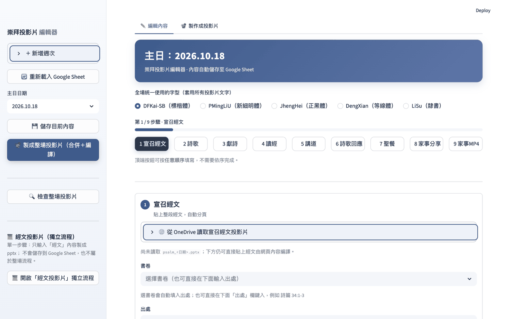
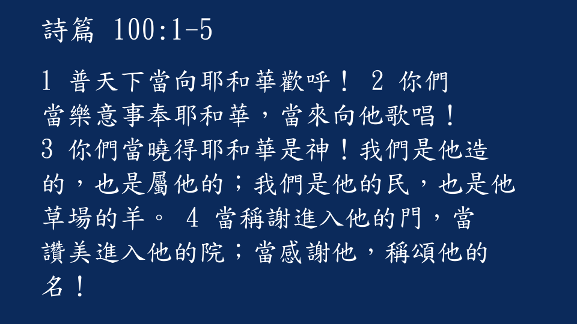
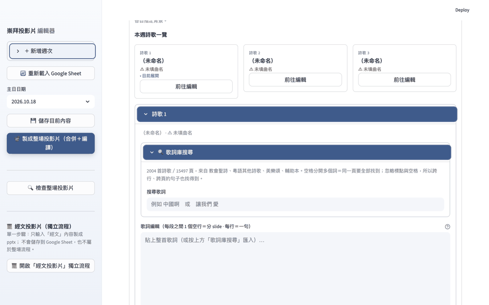
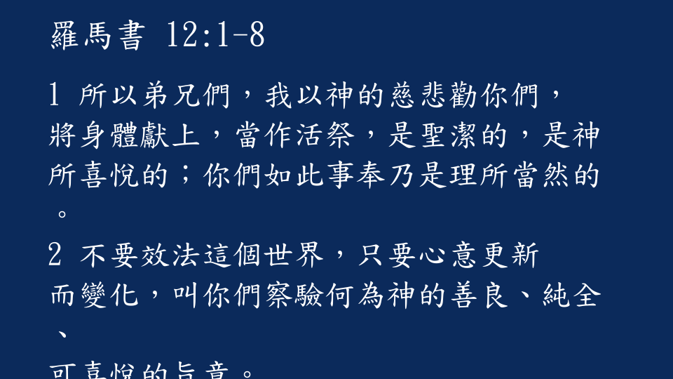
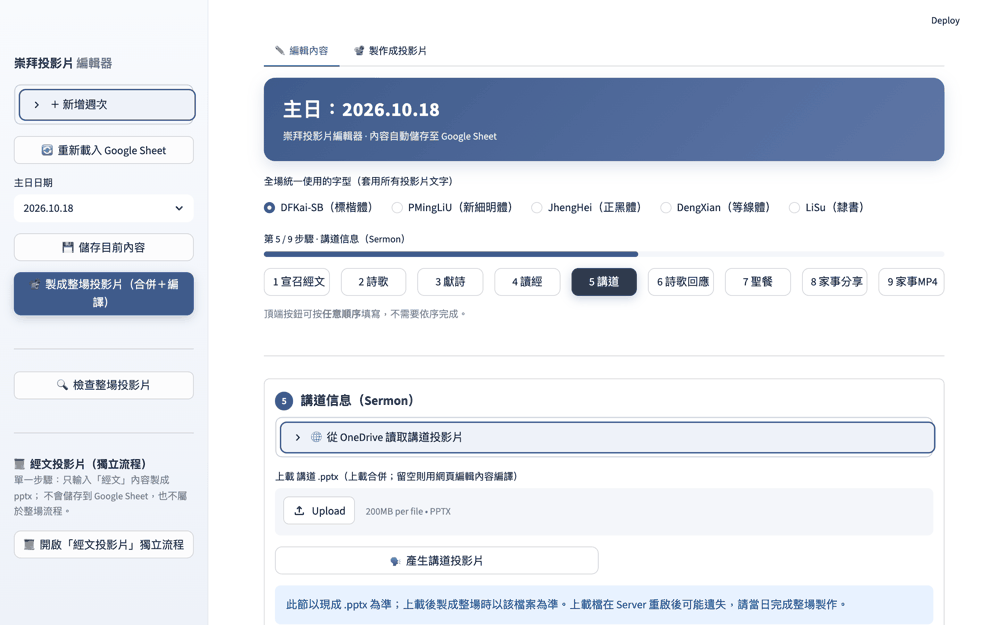
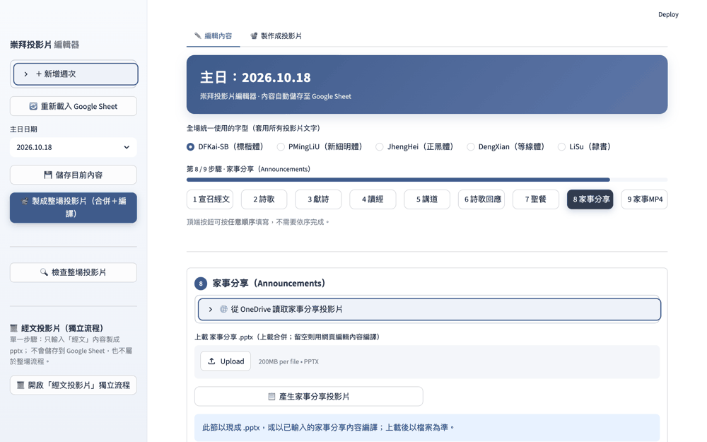

# 崇拜投影片編輯器 · 使用手冊

Streamlit 網頁版。用瀏覽器編輯每個主日的崇拜內容，直接在網頁上產生並下載整場
的 PowerPoint（`.pptx`）。不需要在本機安裝 PowerPoint，也不需要架設伺服器。

- **內容儲存**：週次內容存於 Google 試算表（`weeks` 分頁）；未設定時在本機
  執行會退回 `data/weeks.json`。
- **產出**：`.pptx`（與選用的家事分享 `.mp4`）由瀏覽器下載，不佔伺服器磁碟。

> 本文件對應目前程式碼的功能。若畫面上找不到某個按鈕，代表該節目前是以上載
> 現成檔案為主（見各節說明）。

---

## 1. 開始使用

1. 用瀏覽器開啟 App 網址。
2. 若設定了 `app_password`，會先出現**登入畫面**，輸入密碼後按「登入」或 Enter。
   - 密碼設在 `.streamlit/secrets.toml` 的 `app_password`（部署時貼到
     Streamlit Cloud 的 Settings → Secrets）。
   - 在本機（`localhost` / `127.0.0.1` / `::1`）開啟時會**直接略過密碼**。
   - 未設定 `app_password` 時 App 保持開放，但會顯示提醒。
   - 每次登入成敗會寫入 Google 試算表的 `logs` 分頁；每個登入階段的重要動作
     會彙整到 `sessions` 分頁（登入時間、IP、動作數與摘要）。
3. 進入後停在「✏️ 編輯內容」分頁，預設為**最新**的主日日期；若還沒有資料，
   會以預設週次建立。

### 左側面板

由上到下：

| 控制項 | 用途 |
| --- | --- |
| ＋ 新增週次 | 輸入 `YYYY.MM.DD` 後按「新增並開啟」，建立並切換到新的一週。 |
| 🔄 重新載入 Google Sheet | 清除快取、立即重讀試算表（手動在 Sheet 改過資料時使用）。 |
| 主日日期 | 切換要編輯的主日；切換後編輯頁內容會跟著換。 |
| 💾 儲存目前內容 | 把目前這一頁所有輸入存回資料來源（試算表／本機 JSON）。 |
| 📽 製成整場投影片（合併＋編譯） | 依目前設定產生整份 `Sunday_Service_<日期>.pptx`；成功後下方出現「⬇️ 下載 PPTX」。 |
| 📜 經文投影片（獨立流程） | 開啟只產製「經文」的單一步驟流程，內容**不會**存到試算表，也不屬於整場流程。 |

> **記得按「💾 儲存目前內容」。** 在編輯頁打字時，內容先存在瀏覽器工作階段；
> 切換日期或重新登入前請先儲存。（宣召／讀經用「從 fhl.net 聖經網輸入」抓取時
> 會自動存一次。）

---

## 2. 一個主日的製作流程（速覽）

1. 左側選好**主日日期**（沒有就先「＋ 新增週次」）。
2. 在「✏️ 編輯內容」分頁，照**上方 9 個步驟按鈕**逐節填寫（可按任意順序）。
3. 需要別人的講道／家事分享檔案時，在對應步驟**上載 .pptx**（或用 OneDrive 讀取）。
4. 到「📽 製作成投影片」分頁看「步驟狀態」，確認每一節的來源。
5. 左側按「💾 儲存目前內容」，再按「📽 製成整場投影片」。
6. 按「⬇️ 下載 PPTX」取得 `Sunday_Service_<日期>.pptx`。

下圖為實際操作示範：沿上方 9 個步驟逐節瀏覽，最後切到「📽 製作成投影片」分頁（每張停留 3 秒、循環播放）。

---

## 3. 編輯內容（分頁一）

編輯頁以**嚮導**方式一節一節呈現。最上方是 9 個步驟按鈕，可**任意順序**跳著
填；下方有「⬅ 上一步／下一步 ⬅」。可在最上方先選**全場統一使用的字型**
（DFKai-SB 標楷體／PMingLiU 新細明體／JhengHei 正黑體／DengXian 等線體／
LiSu 隸書），套用到所有投影片文字。

> 以下各節附有 **App 介面操作示範（GIF）**：顯示該步驟在 App 中的實際畫面，
> 由上方往下捲動、循環播放；可用 `make_ui_section_gifs.py` 重新產生。

### 步驟 1 · 宣召經文

- **書卷**：下拉選擇會自動把 FHL 書卷碼填入「出處」；也可直接在「出處」鍵入，
  例如 `詩篇 34:1-3`。
- **譯本版本**：和合本／和合本2010（和修版）／新譯本。切換版本會自動在「出處」
  補上 `（版本）` 並重新抓取內容；也可直接在出處寫 `（和合本）`、`（新譯本）`
  等（支援多種譯本代碼）。
- **從 fhl.net 聖經網輸入**：依「出處」從信望愛聖經網（bible.fhl.net）抓取經文，
  自動填入「內容」。抓取成功也會順手存回試算表一次。
  - 支援多卷書：以 `；`、`;` 或換行分隔，例如 `詩篇 34:1-3；馬太福音 6:9-13`；
    每卷書各自成一段，段首有「書 章:節」標題。
  - 支援範圍 `12:1-8`、跨章 `1:1-2:3`；書卷可用全名或簡稱（詩篇／詩、羅馬書／羅…）。
- **出處字型 / 內文字型（pt）**：出處 20–90；內文 **最低 44pt**，上限 90。
- **經文排版方式**：
  - **整段**：一節接一節連續排版（節碼以上標呈現，適合宣召）。
  - **列表**：一節一行，分頁只會落在節與節之間（適合較長的讀經）。
- **內容**：整段貼上即可，系統會**自動分頁**（見第 7 節）。
- 右上「🌐 從 OneDrive 讀取宣召經文投影片」：若已設定 OneDrive，可讀取
  `psalm_<日期>.pptx` 直接取代排版輸出。

### 步驟 2 · 詩歌敬拜（Hymns）

每首詩歌的歌詞放在**一個編輯框**裡，直接顯示在卡片內。**每個空行分隔的一段＝
一張 slide，段內每行＝一句**；框內會顯示目前共幾段，輸入即時生效——不需要再按
任何「匯入」按鈕，也不再有各段小編輯框。增段＝多留一個空行，刪段＝把該段清空。

- **歌詞庫搜尋**（在每首詩歌卡片內）：
  - 輸入關鍵詞，例如「中國啊」或「讓我們 愛」。**以空格分開多個詞＝同一頁要
    全部找到**；比對會忽略標點與空格，所以跨行、跨頁的句子也找得到。
  - 結果**依歌曲分組**（一首歌只列一次），欄位顯示「曲名 · 詩集 · 找到頁數 —
    歌詞片段」。
  - 選一首歌會彈出「**全首歌詞**」視窗，並以 `<mark>` 標示搜尋字詞。
  - 「**⬇️ 匯入整首詩歌**」會把整首歌詞（已去掉頁首的節數）直接放進歌詞編輯框，
    並用第一頁的標題卡填寫**曲名／英文名／詩集／曲／詞**（第一頁標題卡不計入
    段數）；之後可直接在框內修改。
  - 歌詞庫收錄 4 個詩集：教會聖詩、粵語其他詩歌、美樂頌、輔助本。
- 每首詩歌的欄位：**曲名、英文名、詩集、曲、詞**。
- **背景圖**：展開「🎨 背景圖」，點縮圖**下方的勾選框**即套用（同一首只會勾
  一個；第一格「依序」＝照 `media/song_bg1…` 既定順序）。也可「上傳新背景」，
  或直接把圖片放進 `media/`（檔名 `song_bg*.jpg` 即會出現在縮圖列）。
- **歌詞字級（pt）**：固定字級（**預設 52pt**、可選 48–52pt；不隨行長縮小，
  太長會自動換行）。
- **歌詞文字加上陰影**：勾選後寫入投影片，背景圖上較易閱讀。
- **▶ 預覽這首詩歌的 slides**：按「🎬 產生這首詩歌的 slide」可預覽各頁文字與
  字級（含標題卡），並可下載這首詩歌的獨立 `.pptx`。
- **上載詩歌 .pptx**：上載後整節以檔案為準（字型／項目符號沿用來源檔）；留空
  則用網頁內容現場編譯。也可按「🎵 產生詩歌投影片」先在網頁編譯成獨立檔。
- 「＋ 新增詩歌」增一首；「🗑 移除這首詩歌」會先跳出確認視窗。
- 「✔️ 標記『詩歌敬拜』此節為定稿」：純記號，提醒此節已定稿。

> 「本週詩歌一覽」會為每首詩歌顯示狀態（例如「⚠ 未填曲名」「⚠ 沒有歌詞」
> 「N 段」）與「前往編輯」按鈕，方便快速跳到某一首。

### 步驟 3 · 獻詩（Offering）

- 此節**只接受現成的 `.pptx`**：上載或從 OneDrive 讀取後，製成整場時以檔案為準；
  留空則此節不加入。上載檔在伺服器重啟後可能遺失，請當日完成整場製作。
- 在整場投影片中，獻詩緊接在**禱告／主禱文之後**。

### 步驟 4 · 讀經經文

- 操作與「宣召經文」完全相同（書卷下拉、譯本、從 fhl.net 抓取、字型、整段／
  列表排版、自動分頁）；差別是經文通常較長。

### 步驟 5 · 講道信息（Sermon）

- 此節**以現成 `.pptx` 為準**：在此上載，或從 OneDrive 讀取 `sermon_<日期>.pptx`。
- 「🗣 產生講道投影片」會把目前網頁上的講道內容編譯成獨立檔（若該週已有內容）。

### 步驟 6 · 詩歌回應（Response Hymn）

- **可選**：不需要時直接按「下一步」略過（此節不加入）。
- 單首回應詩歌，欄位與「詩歌敬拜」相同：**一個歌詞編輯框**（空行分段＝一張
  slide）、曲名／英文名／詩集／曲／詞、背景圖、歌詞庫搜尋。
  **歌詞字級與詩歌敬拜共用同一設定**。
- 也可**上載現成 `.pptx` 合併**（以檔案為準）；未上載則用編輯內容現場編譯。
- 「✔️ 標記『詩歌回應』此節為定稿」同前。
- 在整場投影片中，回應詩歌接在**信息之後、聖餐之前**（其標題圖固定使用
  `media/response_hymn.jpg`）。

### 步驟 7 · 聖餐（Communion）

- 勾選「聖餐」後，會在信息／回應之後加入「**聖餐 ＋ 使徒信經**」兩頁。
- **當月第一主日**會自動預設勾選（日期判斷為該月第一個星期日）。
- 若從 OneDrive 讀取 `communion_<日期>.pptx`，會**整組取代**內建的聖餐＋
  使徒信經兩頁（此時即使未勾選聖餐也會採用該檔）。

### 步驟 8 · 家事分享（Announcements）

- 此節**以現成 `.pptx` 為準**：在此上載，或從 OneDrive 讀取
  `announcements_<日期>.pptx`；也可按「📋 產生家事分享投影片」用網頁內容編譯。
- 在整場投影片中，家事分享位於三一頌、祝福之後，倒數第二段（最後是「結束」頁）。

### 步驟 9 · 家事分享 → MP4（影片）

把家事分享做成一段影片，可**併入整場投影片的第一頁**自動循環播放。兩種做法：

1. **直接上載 PowerPoint 匯出的 MP4**（建議）：
   開啟投影片 → 檔案 → 匯出 → 建立影片（或「匯出影片」），選 1080p 並等待
   匯出，再把 `.mp4` 上載到「① 直接上載 PowerPoint 匯出的 MP4」。
2. **由伺服器產製**：若尚未備好影片，可依下列來源用純 Python（Pillow +
   imageio-ffmpeg）產製 H.264 影片：
   - 已上載／已儲存的家事分享 `.pptx`，或
   - 該週已輸入的家事分享內容。

   設定「**投影片編號**」（例如 `1,3,5` 或 `1-3,5`）、「**每張停留秒數**」
   （1–30 秒）與 **fps**（15／20／24／30），按「🎞 產生影片（MP4）」。

完成後：

- 「⬇️ 下載 MP4」可取得 `announcements_<日期>.mp4`。
- 勾選「**把影片併入整場投影片的第一頁**（自動循環播放，直到點擊下一頁）」後，
  按左側「📽 製成整場投影片」，影片會成為整場的**第一頁**（在第 1 頁 welcome 之前）。

---

## 4. 製作成投影片（分頁二）

這一頁用來**檢查每一節的來源**，並設定家事分享圖片。實際的「產生」按鈕在左側
面板。（上載與各節「個別產生」都在「✏️ 編輯內容」各步驟內。）

- **步驟狀態（A）**：逐節顯示來源：
  - `✅` — 已上載／已從雲端讀取／已儲存（製成時以該檔案為準），並可「✖ 移除」。
  - `🧩` — 由網頁內容編譯。
  - 經文節若未上載檔案，會顯示出處與行數（或「未填寫」）。
  - 聖餐會顯示是否加入；家事 MP4 會顯示是否已產製、是否併入第一頁。
- **合併先前各步驟投影片檔**（預設勾選）：勾選時，製成整場會直接合併先前個別
  產生／上載的各節 `.pptx`，不重新編譯；取消則全部改用網頁內容現場編譯。
- **家事分享圖片（圖片型家事分享，可選）**：若家事分享是「圖片型」，可為每張
  附加 jpg／png／webp 圖片。

檢查無誤後，按左側「📽 製成整場投影片（合併＋編譯）」；成功時顯示「完成：N 頁」，
並在下方出現「⬇️ 下載 PPTX」。

- **🔍 檢查整場投影片**：產生整場後可按此
  按鈕一次核對：
  - **讀經 ↔ 講道經文**：「讀經經文」與「講道信息」的經文出處是否一致
    （講道經文取自**信息的前四張投影片**）。會同時核對內容欄位與已產生的投影片
    （含從 `.pptx` 匯入的章節）；兩處都未填或範圍不同時會提示，出處相同
    （或一者涵蓋另一者）則標示相符。
  - **詩歌頁數**：**所有詩歌**（**詩歌敬拜／獻詩／詩歌回應**）每首（**含標題卡**）
    至少 4 頁；不足 4 頁的會列為警示（常見於歌詞段落太少，或該首尚未填歌詞）。
    頁數是從**產生的投影片**實際計算（已存的各節 pptx、本次上載的檔案為準；
    未存檔則以內容現場編譯；獻詩沒有內容欄位，只能由上載的 pptx 計算）。
    本 App 產生的投影片以每頁的「N/M」頁碼分首；若該節 pptx 是從外部匯入
    （沒有頁碼），則以字級較大的標題卡自動分首，並略過「詩歌敬拜／獻詩／
    詩歌回應」章節標題卡。
  - **歌詞比對**：把每首歌投影片上實際的歌詞，與內容欄位輸入／**修改後**的歌詞
    逐行比對（忽略標點與換行）。若兩者不同（例如改了歌詞卻沒有重新產生投影片，
    或上載的詩歌 pptx 內容有誤），會列出「內容有…未見於投影片」及「投影片有…
    不在內容中」的行數與例子。詩歌敬拜／詩歌回應有內容欄位可比對；獻詩沒有內容
    欄位，則不列入比對。
  - **用字對照（對照內建歌詞庫）**：把每首歌的歌詞與內建歌詞庫
    （`lyrics/教會聖詩`／`粵語其他詩歌`／`美樂頌`／`輔助本`）中同名的一首逐行對照，
    找出**可能用錯字**的地方：與詩集某行極為相似但不完全相同者，會列出「內容…／
    詩集…」及差異字元（例如 `〔赦→赫〕`）。這是**提示**而非硬性錯誤——詩集版本
    可能與你所用不同，請自行核對；標點、空格與換行不計，`祢/祂` 視為 `你/他`。
    找不到對應詩集（或歌詞完全對不上）的詩歌會略過。
  - **第一主日樣板**：若當日為當月第一主日，會確認投影片中含有「聖餐」＋
    「使徒信經」樣板頁；缺少時提示（若改用雲端 `communion_<日期>.pptx` 取代
    內建樣板，則可略過此提示）。
  按鈕隨時可按，尚未產生整場時改以內容欄位估算。

---

## 5. 整場投影片的頁面順序

（開啟 `Sunday_Service_<日期>.pptx` 後；若選用影片併入第一頁，影片會在最前面）

固定頁 ＋ 各節：

1. 開場（welcome）
2. 宣召標題圖 → **宣召經文**
3. 詩歌敬拜標題圖 → **詩歌敬拜**
4. 禱告標題圖 → 主禱文
5. **獻詩**（若有上載）
6. 讀經標題圖 → **讀經經文**
7. 信息標題圖 → **講道信息**
8. **詩歌回應**（若使用）
9. **聖餐 ＋ 使徒信經**（若勾選或有雲端檔）
10. 三一頌 → 祝福
11. 家事分享標題圖 → **家事分享**
12. 結束

各節標題背景圖取自 `media/`（可用「產生／背景」相關設定或 `media/` 內容替換）。

---

## 6. 經文投影片（獨立流程）

左側「📜 開啟『經文投影片』獨立流程」是一個**單一步驟**頁面：選全場字型、輸入
出處（可從 fhl.net 抓取）或直接貼上整段經文，按「📜 製成經文投影片 pptx」即可
下載 `scripture_<日期>.pptx`。

- 內容使用獨立的 `scrflow_*` 工作階段變數，**不會**存到 Google 試算表。
- 產生的檔案屬於獨立流程，**不會**被「製成整場投影片」讀取或合併。

---

## 7. 經文自動分頁規則

- 貼上的經文視為一段連續文字；系統依**字型大小**推算每行可容納字數，再依文字框
  高度決定每頁行數，自動切成多頁。
- **內文字型最低 44pt**（預設 44pt，可調高）。
- 分頁會避開標點：每一頁（行）**結尾不會是標點符號**，下一頁也不以標點開頭。
- 中文沒有詞間空格，因此換頁點會落在句子中間。
- 「**整段**」＝連續排版、節碼上標；「**列表**」＝一節一行，分頁只落在節與節之間。

---

## 8. 從 OneDrive 讀取（選用）

若管理員已在 Secrets 設定 `[onedrive]`（tenant_id／client_id／client_secret／
site_host／site_path／folder_path），每一節的「🌐 從 OneDrive 讀取…投影片」面板
會列出該日期資料夾的檔案，選檔後按「⚡ 從 OneDrive 讀取並儲存」。

- 每節預期檔名為該節的標準檔名（例如 `psalm_<日期>.pptx`、`sermon_<日期>.pptx`、
  `announcements_<日期>.mp4`）；資料夾與檔名可含 `YYYY.MM.DD`／`YYYY-MM-DD`／
  `YYYYMMDD`／`YYYY.MMDD` 等日期寫法。
- 家事 MP4 會在整個資料夾樹（含子資料夾）搜尋 `.mp4`。

---

## 9. 資料與儲存

- **週次內容**：寫入 Google 試算表 `weeks` 分頁（欄位：`date | json | updatedAt`）。
  Streamlit Community Cloud 的伺服器磁碟是暫時性的，重啟／重新部署會清空，因此
  內容不放伺服器檔案。未設定試算表時，本機執行改用 `data/weeks.json`。
- **快取**：讀取試算表有約 30 秒快取；手動在 Sheet 改過資料後可按左側
  「🔄 重新載入 Google Sheet」立即重讀。
- **登入紀錄**：`logs`（每次登入成敗）與 `sessions`（每個登入階段的動作摘要）
  分頁；本機無憑證時退回 `data/login_log.json`、`data/sessions.json`。
- **各節個別產生的檔案與影片**：存在伺服器 `data/decks/<日期>/`。雲端會隨重啟
  清除，本機則保留；同一天再製成整場時會自動沿用（除非取消「合併先前各步驟
  投影片檔」）。
- **上載的圖片**（例如圖片型家事分享、自訂詩歌背景）為**工作階段專屬**，不會
  回存試算表，重啟後需重新上載。
- **新增週次的預設內容**：新週次會帶入 `sample_week.json` 的範例（宣召詩篇
  34:1-3、讀經羅馬書 12:1-8、三首空白詩歌），可直接覆蓋；若日期為當月第一主日，
  聖餐會預設勾選。

---

## 10. 常見問題（FAQ）

**Q：PowerPoint 說合併後的檔案「需要修復」？**
A：合併會把各節原封不動搬入（連同版面／母片／佈景主題／圖片），並處理母片／
版面 ID 衝突。若仍發生，請確認來源 `.pptx` 本身在 PowerPoint 能正常開啟。

**Q：上載檔案後，編輯頁還要填嗎？**
A：不用。該節只要上載了檔案，製成時就以檔案為準；可混用（例如詩歌用檔案、
讀經用網頁內容）。

**Q：改了編輯頁內容，製成結果卻沒變？**
A：可能該節有上載檔案，或「合併先前各步驟投影片檔」沿用了舊檔。到「製作成
投影片 → 步驟狀態」用「✖ 移除」清除，或取消該勾選，再重新製成。

**Q：下載按鈕不見了？**
A：下載按鈕只顯示目前日期最近一次產生的結果。請再按左側「📽 製成整場投影片」。

**Q：為什麼重整畫面後，上載的檔案／影片還在？**
A：各節上載與個別產生的檔案會存到 `data/decks/<日期>/` 以便跨重整沿用；但雲端
重啟後會清除，需要重新上載或重新產生。

**Q：某些欄位切換步驟後打好的字不見了？**
A：本版會在步驟間保留未儲存的編輯（每個日期各自保存草稿），但**切換日期或重新
登入前請務必按「💾 儲存目前內容」**。

**Q：抓取經文後要再按儲存嗎？**
A：用「從 fhl.net 聖經網輸入」成功時會自動存一次；其他欄位變更仍需手動儲存。

**Q：聖餐怎麼沒有自動出現？**
A：聖餐僅在勾選時加入；**當月第一主日**會預設勾選。若不是第一主日卻要加，請
到「步驟 7 · 聖餐」自行勾選。

---

_檔名：`user_manual.md`（繁中）。English version: `user_manual.en.md`。_
